# Poly Haven: Stone textures

**37 assets from [Poly Haven](https://polyhaven.com), dedicated to the public domain under [CC0](https://polyhaven.com/license).** Use them in any game, free or paid, and change them however you like; no credit is needed.

PBR textures as 1K and 2K JPG maps (colour, normal (GL and DX), roughness, AO, displacement and more). 882.2 MB in all.

This is a copy kept by [zuujis-cc0](https://github.com/zuujis-cc0) so game makers can take single files from GitHub. It is not made by or affiliated with Poly Haven: the originals, often in more formats and higher resolutions, are on [polyhaven.com](https://polyhaven.com). If they help you, consider [supporting Poly Haven](https://www.patreon.com/polyhaven/overview).

Every file is listed in [MANIFEST.tsv](MANIFEST.tsv) with its size and SHA-256. More free assets: [the Zuujis collection](https://github.com/zuujis-cc0/free-game-assets#readme).

| | | | |
| :-: | :-: | :-: | :-: |
| <a href="rock_wall_15">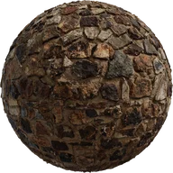</a> <b><a href="rock_wall_15">Rock Wall 15</a></b> by Dimitrios Savva · <a href="https://polyhaven.com/a/rock_wall_15">source</a> | <a href="rock_wall_16">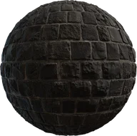</a> <b><a href="rock_wall_16">Rock Wall 16</a></b> by Amal Kumar · <a href="https://polyhaven.com/a/rock_wall_16">source</a> | <a href="rock_wall_17">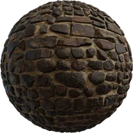</a> <b><a href="rock_wall_17">Rock Wall 17</a></b> by Dimitrios Savva · <a href="https://polyhaven.com/a/rock_wall_17">source</a> | <a href="roof_slates_02">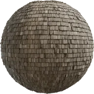</a> <b><a href="roof_slates_02">Roof Slates 02</a></b> by Rob Tuytel · <a href="https://polyhaven.com/a/roof_slates_02">source</a> |
| <a href="roof_slates_03">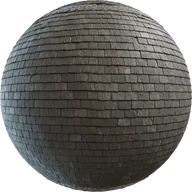</a> <b><a href="roof_slates_03">Roof Slates 03</a></b> by Rob Tuytel · <a href="https://polyhaven.com/a/roof_slates_03">source</a> | <a href="rustic_stone_wall">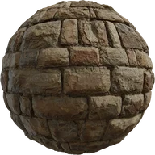</a> <b><a href="rustic_stone_wall">Rustic Stone Wall</a></b> by Dimitrios Savva · <a href="https://polyhaven.com/a/rustic_stone_wall">source</a> | <a href="rustic_stone_wall_02">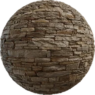</a> <b><a href="rustic_stone_wall_02">Rustic Stone Wall 02</a></b> by Amal Kumar · <a href="https://polyhaven.com/a/rustic_stone_wall_02">source</a> | <a href="sandstone_cracks">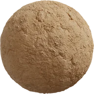</a> <b><a href="sandstone_cracks">Sandstone Cracks</a></b> by Rob Tuytel · <a href="https://polyhaven.com/a/sandstone_cracks">source</a> |
| <a href="seaside_rock">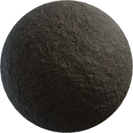</a> <b><a href="seaside_rock">Seaside Rock</a></b> by Dimitrios Savva · <a href="https://polyhaven.com/a/seaside_rock">source</a> | <a href="slab_tiles">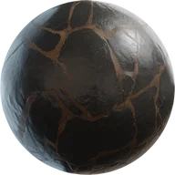</a> <b><a href="slab_tiles">Slab Tiles</a></b> by Dario Barresi, Dimitrios Savva · <a href="https://polyhaven.com/a/slab_tiles">source</a> | <a href="slate_driveway">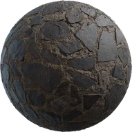</a> <b><a href="slate_driveway">Slate Driveway</a></b> by Dimitrios Savva · <a href="https://polyhaven.com/a/slate_driveway">source</a> |  <b><a href="slate_floor">Slate Floor</a></b> by Dimitrios Savva · <a href="https://polyhaven.com/a/slate_floor">source</a> |
| <a href="slate_floor_02">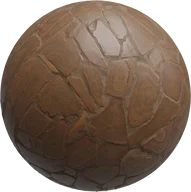</a> <b><a href="slate_floor_02">Slate Floor 02</a></b> by Dimitrios Savva · <a href="https://polyhaven.com/a/slate_floor_02">source</a> | <a href="slate_floor_03">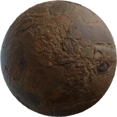</a> <b><a href="slate_floor_03">Slate Floor 03</a></b> by Dimitrios Savva · <a href="https://polyhaven.com/a/slate_floor_03">source</a> | <a href="square_cobblestone">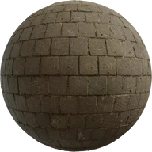</a> <b><a href="square_cobblestone">Square Cobblestone</a></b> by Sơn Nguyễn · <a href="https://polyhaven.com/a/square_cobblestone">source</a> | <a href="square_floor">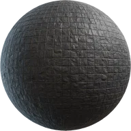</a> <b><a href="square_floor">Square Floor</a></b> by Rob Tuytel · <a href="https://polyhaven.com/a/square_floor">source</a> |
| <a href="square_floor_patern_01">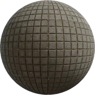</a> <b><a href="square_floor_patern_01">Square Floor Patern 01</a></b> by Rob Tuytel · <a href="https://polyhaven.com/a/square_floor_patern_01">source</a> | <a href="square_tiles_02">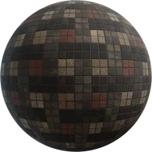</a> <b><a href="square_tiles_02">Square Tiles 02</a></b> by Charlotte Baglioni · <a href="https://polyhaven.com/a/square_tiles_02">source</a> | <a href="square_tiles_03">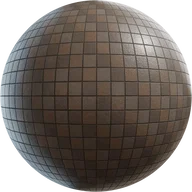</a> <b><a href="square_tiles_03">Square Tiles 03</a></b> by Charlotte Baglioni · <a href="https://polyhaven.com/a/square_tiles_03">source</a> | <a href="stacked_stone_wall">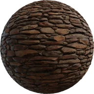</a> <b><a href="stacked_stone_wall">Stacked Stone Wall</a></b> by Dimitrios Savva · <a href="https://polyhaven.com/a/stacked_stone_wall">source</a> |
| <a href="stone_block_wall">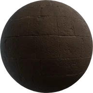</a> <b><a href="stone_block_wall">Stone Block Wall</a></b> by Amal Kumar · <a href="https://polyhaven.com/a/stone_block_wall">source</a> | <a href="stone_embedded_tiles">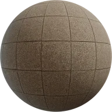</a> <b><a href="stone_embedded_tiles">Stone Embedded Tiles</a></b> by Dimitrios Savva · <a href="https://polyhaven.com/a/stone_embedded_tiles">source</a> | <a href="stone_floor">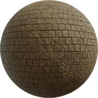</a> <b><a href="stone_floor">Stone Floor</a></b> by Dimitrios Savva · <a href="https://polyhaven.com/a/stone_floor">source</a> | <a href="stone_pathway">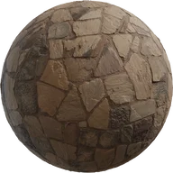</a> <b><a href="stone_pathway">Stone Pathway</a></b> by Amal Kumar · <a href="https://polyhaven.com/a/stone_pathway">source</a> |
| <a href="stone_pathway_02">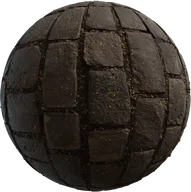</a> <b><a href="stone_pathway_02">Stone Pathway 02</a></b> by Amal Kumar · <a href="https://polyhaven.com/a/stone_pathway_02">source</a> | <a href="stone_pavers">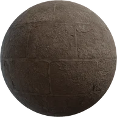</a> <b><a href="stone_pavers">Stone Pavers</a></b> by Amal Kumar · <a href="https://polyhaven.com/a/stone_pavers">source</a> | <a href="stone_tile_wall">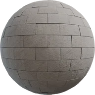</a> <b><a href="stone_tile_wall">Stone Tile Wall</a></b> by Charlotte Baglioni · <a href="https://polyhaven.com/a/stone_tile_wall">source</a> | <a href="stone_tiles">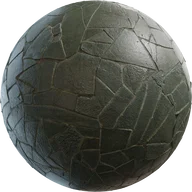</a> <b><a href="stone_tiles">Stone Tiles</a></b> by Christopher Melani · <a href="https://polyhaven.com/a/stone_tiles">source</a> |
| <a href="stone_tiles_02">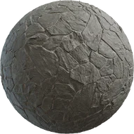</a> <b><a href="stone_tiles_02">Stone Tiles 02</a></b> by Charlotte Baglioni · <a href="https://polyhaven.com/a/stone_tiles_02">source</a> | <a href="stone_tiles_03">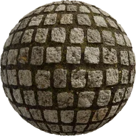</a> <b><a href="stone_tiles_03">Stone Tiles 03</a></b> by eye-candy.xyz · <a href="https://polyhaven.com/a/stone_tiles_03">source</a> | <a href="stone_wall">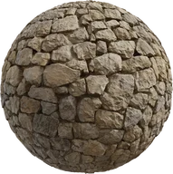</a> <b><a href="stone_wall">Stone Wall</a></b> by Charlotte Baglioni, Dario Barresi · <a href="https://polyhaven.com/a/stone_wall">source</a> | <a href="stone_wall_02">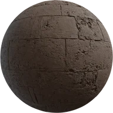</a> <b><a href="stone_wall_02">Stone Wall 02</a></b> by Charlotte Baglioni, Dario Barresi · <a href="https://polyhaven.com/a/stone_wall_02">source</a> |
| <a href="stone_wall_03">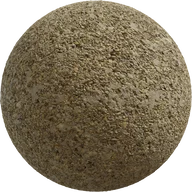</a> <b><a href="stone_wall_03">Stone Wall 03</a></b> by eye-candy.xyz · <a href="https://polyhaven.com/a/stone_wall_03">source</a> | <a href="stone_wall_04">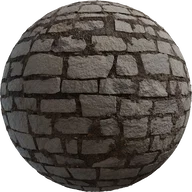</a> <b><a href="stone_wall_04">Stone Wall 04</a></b> by Amal Kumar · <a href="https://polyhaven.com/a/stone_wall_04">source</a> | <a href="tiger_rock">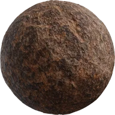</a> <b><a href="tiger_rock">Tiger Rock</a></b> by Dario Barresi · <a href="https://polyhaven.com/a/tiger_rock">source</a> |  <b><a href="volcanic_herringbone_01">Volcanic Herringbone 01</a></b> by Charlotte Baglioni · <a href="https://polyhaven.com/a/volcanic_herringbone_01">source</a> |
| <a href="volcanic_rock_tiles">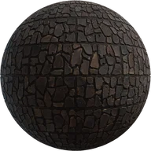</a> <b><a href="volcanic_rock_tiles">Volcanic Rock Tiles</a></b> by Charlotte Baglioni · <a href="https://polyhaven.com/a/volcanic_rock_tiles">source</a> |  |  |  |

---

Kept up to date by this repository's own [update workflow](.github/workflows/update.yml), with code and plan from [cc0-mirror](https://github.com/zuujis-cc0/cc0-mirror). Something wrong? [Open an issue there](https://github.com/zuujis-cc0/cc0-mirror/issues/new) or use the [private report form](https://games.zuujis.com/report).
